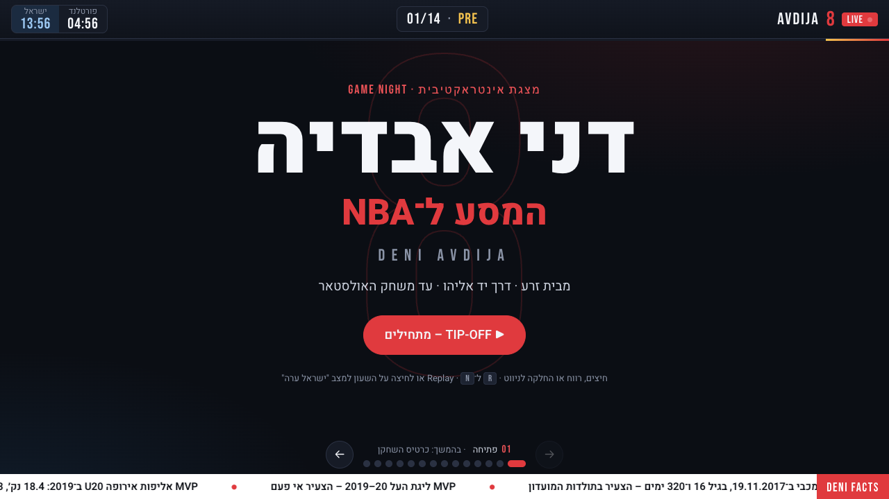
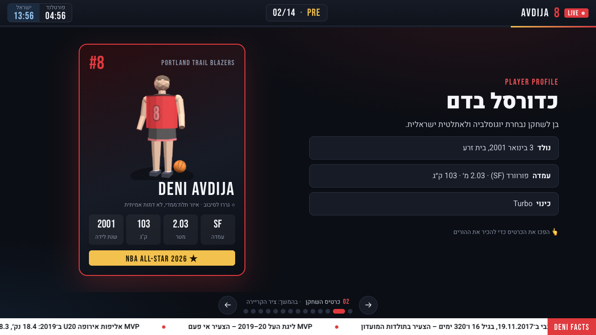
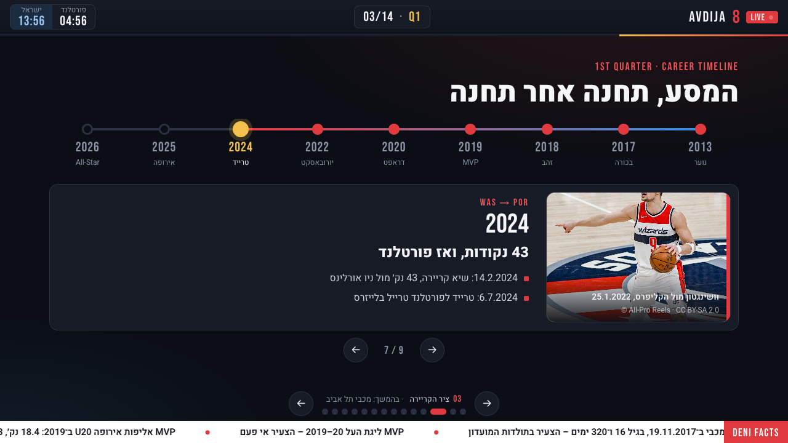
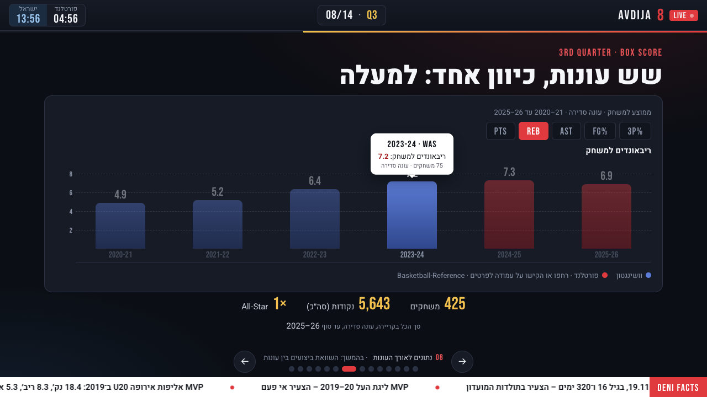
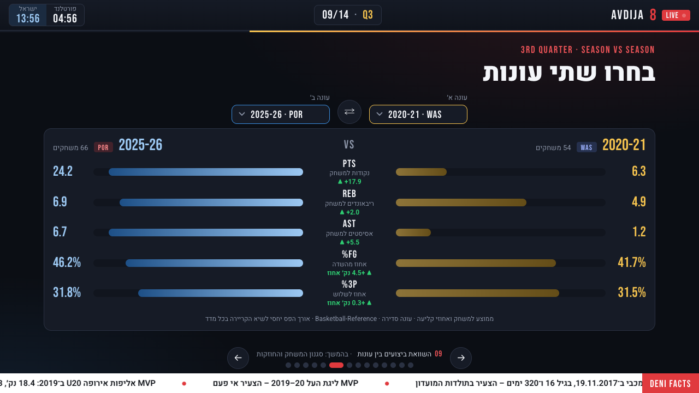
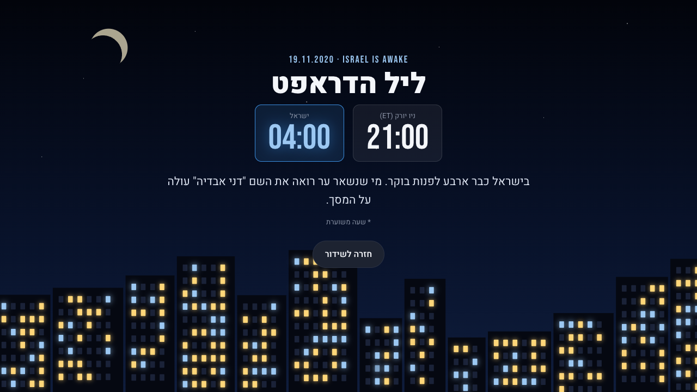
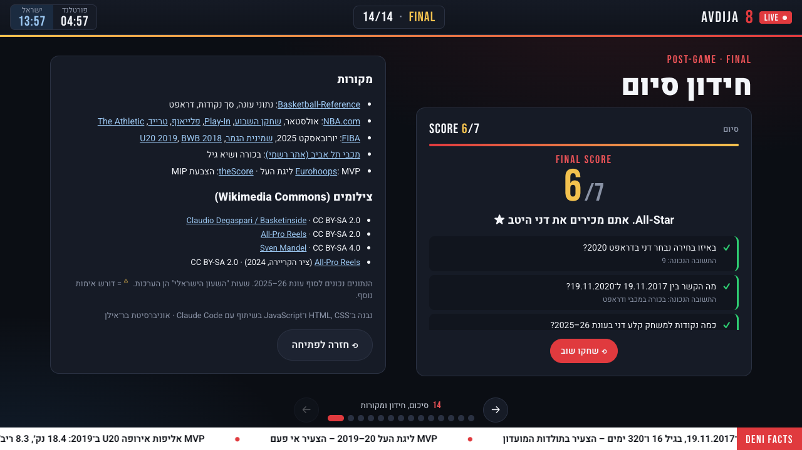
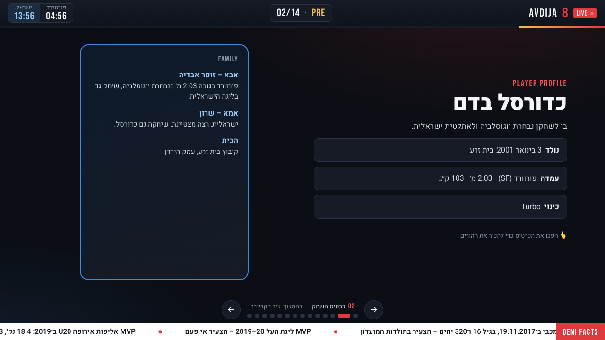
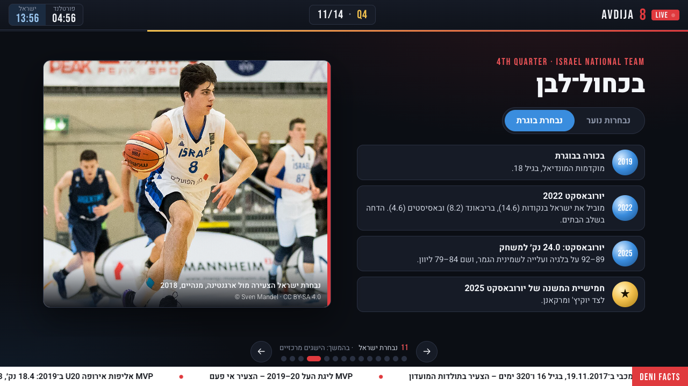
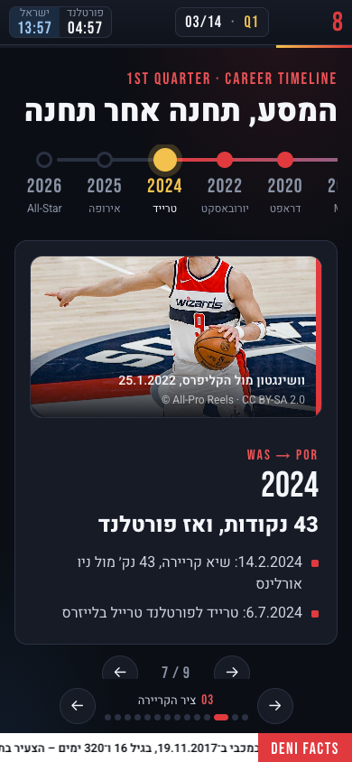

# Game Night: דני אבדיה – המסע ל־NBA



מצגת אינטראקטיבית בעברית על הקריירה של **דני אבדיה**, מבית זרע ומכבי תל אביב ועד משחק האולסטאר של ה־NBA. המצגת בנויה כמו **שידור משחק כדורסל בטלוויזיה**: לוח תוצאות (Scorebug), ארבעה רבעים, טיקר עובדות רץ ומעברי Replay. היא נכתבה ב־HTML, CSS ו־JavaScript בלי Framework. הספרייה החיצונית היחידה היא Three.js, ורק עבור הדמות התלת־ממדית בכרטיס השחקן.

> **פרויקט אקדמי · אוניברסיטת בר־אילן** · פותח בשיתוף עם Claude Code (Opus 5.5). מנהל הפרויקט (הסטודנט) כתב כל הנחיה ואישר כל שלב, וה־AI פעל כסוכן פיתוח.

| מסמך | תוכן |
|---|---|
| [`docs/PRD.md`](docs/PRD.md) | מסמך הדרישות: מטרות, קהל יעד, דרישות, קריטריוני קבלה, אבני דרך, סיכונים, ומרשם עובדות עם מקור לכל נתון |
| [`docs/TEST_REPORT.md`](docs/TEST_REPORT.md) | דו"ח הבדיקות: 25 בדיקות, בעיות, תיקונים, ומה לא נבדק |
| [`docs/AI_CONVERSATION_LOG.md`](docs/AI_CONVERSATION_LOG.md) | יומן העבודה עם ה־AI: הנחיות, החלטות, הצעות ותיקונים, לפי תורות |
| [`docs/ai-transcript/TRANSCRIPT.md`](docs/ai-transcript/TRANSCRIPT.md) | **התמלול המלא** של השיחה עם ה־AI, מילה במילה, מתוך ייצוא הסשן |
| [`docs/DECISION_LOG.md`](docs/DECISION_LOG.md) | יומן החלטות שנכתב לאורך כל העבודה, שלב אחר שלב |
| [`docs/SUBMISSION_REPORT.md`](docs/SUBMISSION_REPORT.md) | דו"ח ההגשה: מה הושלם, מה חלקי, ומה לאמת מול המרצה |
| [GitHub](https://github.com/tommaster8/Deni-Avdija) | הקוד וההיסטוריה המלאה של השינויים |

---

## תוכן העניינים
1. [תיאור המצגת](#1-תיאור-המצגת)
2. [מטרות הפרויקט](#2-מטרות-הפרויקט)
3. [למה דני אבדיה](#3-למה-דני-אבדיה)
4. [מבנה המצגת](#4-מבנה-המצגת)
5. [האלמנטים האינטראקטיביים](#5-האלמנטים-האינטראקטיביים)
6. [צילומי מסך](#6-צילומי-מסך)
7. [טכנולוגיות](#7-טכנולוגיות)
8. [מבנה הקבצים](#8-מבנה-הקבצים)
9. [התקנה והרצה](#9-התקנה-והרצה)
10. [תהליך העבודה](#10-תהליך-העבודה)
11. [השיפורים בין הגרסאות](#11-השיפורים-בין-הגרסאות)
12. [אתגרים ופתרונות](#12-אתגרים-ופתרונות)
13. [מקורות המידע](#13-מקורות-המידע)
14. [בדיקות ומגבלות ידועות](#14-בדיקות-ומגבלות-ידועות)

---

## 1. תיאור המצגת
14 שקופיות שמספרות את הקריירה כרצף של "משחק": **PRE** ← **Q1** ← **Q2** ← **Q3** ← **Q4** ← **FINAL**. סרגל השידור בראש המסך מציג תמיד את הרבע, את מספר השקופית ושעון כפול, פורטלנד מול ישראל.

**הרעיון המקורי, "השעון הישראלי":** ברגעי מפתח (הדראפט, שיא הקריירה, האולסטאר) השעון מראה מה השעה הייתה **בישראל** באותו רגע. לחיצה עליו פותחת את מצב **"ישראל ערה"**, סצנת לילה של עיר ישראלית שבה החלונות נדלקים אחד אחרי השני. הרעיון מחבר בין הנתונים לבין החוויה של האוהד הישראלי שקם באמצע הלילה כדי לצפות.

## 2. מטרות הפרויקט
| # | מטרה |
|---|---|
| G1 | לספר את המסע של דני כרצף ברור, ב־10 נושאי תוכן |
| G2 | להציג **רק נתונים אמיתיים ומאומתים**, עם מקור לכל נתון |
| G3 | חוויה של אתר ספורט מודרני ולא של מצגת PowerPoint |
| G4 | לאפשר לצופה לחקור את הנתונים בעצמו: גרפים והשוואת עונות |
| G5 | בידול: "השעון הישראלי" |
| G6 | תהליך עבודה מקצועי עם AI: תכנון, גרסאות, בדיקות ותיעוד |

הפירוט המלא, עם מדדי הצלחה, נמצא ב־[PRD, סעיף 2](docs/PRD.md).

## 3. למה דני אבדיה
- **סיפור עם קשת ברורה:** הוא הצעיר בתולדות מכבי (16 שנים ו־320 ימים), MVP של ליגת העל בגיל 19, הבחירה הגבוהה ביותר אי פעם של ישראלי בדראפט (9), ובעונת 2025–26 **הישראלי הראשון במשחק האולסטאר**.
- **הרבה נתונים:** שש עונות NBA עם שינוי בולט מעונה לעונה (6.3 ← 24.2 נקודות למשחק). זה מתאים במיוחד לגרפים ולהשוואות.
- **חיבור ישראלי:** הפער בשעות בין ארה"ב לישראל נתן את הרעיון המקורי של המצגת.

## 4. מבנה המצגת
| # | רבע | שקופית | תוכן |
|---|---|---|---|
| 1 | PRE | פתיחה | "דני אבדיה – המסע ל־NBA" |
| 2 | PRE | כרטיס השחקן | דמות תלת־ממדית מסתובבת, נתוני גוף, ובגב הכרטיס הרקע המשפחתי |
| 3 | Q1 | **ציר הקריירה** | 9 תחנות, מ־2013 ועד 2026 |
| 4 | Q1 | מכבי תל אביב | הבכורה, 3 אליפויות, MVP ו"רגע הקסם" ביורוליג |
| 5 | Q2 | דראפט 2020 | בחירה 9, והצירוף 19.11 (בכורה ב־2017, דראפט ב־2020) |
| 6 | Q2 | וושינגטון ויזארדס | 2020–2024, גרף קווי, חוזה ושיא קריירה |
| 7 | Q2 | פורטלנד | טרייד, שחקן השבוע, אולסטאר, Play-In ופלייאוף |
| 8 | Q3 | **נתונים לאורך העונות** | גרף עמודות דינמי, וסיכום קריירה |
| 9 | Q3 | **השוואת עונות** | כל שתי עונות, 5 מדדים |
| 10 | Q3 | סגנון המשחק | 6 חוזקות, כל אחת עם נתון ומקור |
| 11 | Q4 | נבחרת ישראל | נוער ובוגרים |
| 12 | Q4 | ארון ההישגים | 8 הישגים |
| 13 | Q4 | ההשפעה | כספי (2009) ← אבדיה (2020) ← All-Star (2026) |
| 14 | FINAL | **חידון**, מקורות וקרדיטים | 7 שאלות ומסך סיכום |

## 5. האלמנטים האינטראקטיביים
| רכיב | שקופית | מה אפשר לעשות | קוד |
|---|---|---|---|
| **ניווט** | הכל | חיצים (ב־RTL ← הוא "הבא"), רווח, PgUp/PgDn, Home/End, כפתורים, נקודות, החלקה בנייד, וקישור ישיר `#1`–`#14` | `js/core/navigation.js` |
| **אינדיקציה** | הכל | רבע ומספר בסרגל, שם השקופית ו"בהמשך:" מעל הנקודות, ופס התקדמות | `js/core/navigation.js` |
| **השעון הישראלי** ו**"ישראל ערה"** | 5, 6, 7 ושעון בכל השקופיות | לחיצה על השעון או מקש N פותחים סצנת לילה. Esc סוגר | `js/core/clock.js` |
| **ציר הקריירה** | 3 | לחיצה על שנה, כפתורי ←/→ או חיצי מקלדת. סימון בזהב, פס התקדמות, מעבר לפי כיוון התנועה, ותמונה בכל תחנה שיש לה צילום | `js/components/timeline.js` |
| **גרף דינמי** | 8 | PTS, REB, AST, FG% ו־3P%. העמודות עוברות מהערך הקודם לחדש, ציר Y עגול, וטולטיפ בריחוף או בהקשה | `js/components/charts.js` |
| **גרף קווי** | 6 | PTS, REB ו־AST בעונות וושינגטון. הקו "מצטייר" מחדש | `js/components/charts.js` |
| **השוואת עונות** | 9 | שתי רשימות בחירה ו־⇄. פסי מראה, והפרש עם חץ וצבע | `js/components/compare.js` |
| **חידון** | 14 | 7 שאלות, 4 תשובות לכל שאלה, משוב מיידי, ניקוד מונפש, ומסך סיכום עם סקירת כל השאלות | `js/components/quiz.js` |
| **דמות תלת־ממדית** | 2 | שחקן Low-Poly מסוגנן במספר 8 שמסתובב ומכדרר. גרירה מסובבת אותו עם תנופה. **זה איור כללי ולא דמותו של דני**, וזה כתוב בכרטיס. Three.js נטען רק בכניסה לשקופית, והרינדור נעצר כשהכרטיס הפוך או בשקופית אחרת. בלי אינטרנט מוצגת צללית SVG | `js/components/player3d.js` |
| **כרטיס מתהפך** | 2 | לחיצה הופכת את הכרטיס. גרירה של הדמות לא נחשבת ללחיצה | `js/components/interactions.js` |
| **טאבים** | 11 | נבחרות נוער מול נבחרת בוגרת | `js/components/interactions.js` |
| **אנימציות** | הכל | מעבר Replay (מקש R), כניסה מדורגת, מספרים רצים, Ripple בלחיצה, הרמת כרטיסים ב־hover. תמיכה ב"תנועה מופחתת" | `css/animations.css`, `css/interactive.css` |

## 6. צילומי מסך
כל הצילומים **אמיתיים**: Chrome ללא ממשק צילם את המצגת כפי שהיא, בגודל 1280×720. מצבים שדורשים פעולה (תחנה בציר, טולטיפ, חידון) הופעלו בלחיצות אמיתיות דרך [`tests/screenshot.html`](tests/screenshot.html). הצילומים נוצרים מחדש עם `node tests/capture-screenshots.mjs`.

### כרטיס השחקן: דמות תלת־ממדית (איור מסוגנן, לא דמות אמיתית)


### ציר הקריירה: תחנת 2024 נבחרה


### גרף דינמי: מדד הריבאונדים, עם טולטיפ על 2023–24


### השוואת עונות: 2020–21 מול 2025–26


### "ישראל ערה": ליל הדראפט, 04:00 בישראל


### חידון: מסך הסיכום (6/7)


### עוד צילומים
| כרטיס השחקן (הצד האחורי) | נבחרת ישראל (טאב בוגרת) | נייד 390×844 |
|---|---|---|
|  |  |  |

## 7. טכנולוגיות
| תחום | בחירה | למה |
|---|---|---|
| מבנה | HTML5 סמנטי, `dir="rtl"` | דרישת המטלה ועברית |
| עיצוב | CSS3: טוקנים ב־`:root`, Grid, Flexbox, `clamp()`, Media Queries ו־`prefers-reduced-motion` | בלי Build, ושליטה מלאה |
| לוגיקה | JavaScript (ES2020) בלי Framework, במרחב שמות `GN` | נפתח ישירות בדפדפן |
| גרפים | SVG ו־DOM שנכתבו ידנית | **בלי Chart.js, GSAP או D3:** בלי תלות באינטרנט בכיתה, ובלי משקל נוסף |
| תלת־ממד | [Three.js r128](https://threejs.org) מ־cdnjs, בגרסה נעולה | הדמות בכרטיס השחקן בלבד. נטען בעצלות (רק בשקופית 2), ובלי רשת יש צללית SVG |
| גופנים | Heebo (עברית) ו־Bebas Neue (מספרים) מ־Google Fonts | עם גופני גיבוי |
| תמונות | 4 צילומים ברישיון CC BY-SA מ־Wikimedia Commons | זכויות יוצרים |
| בדיקות | דף בדיקות אוטומטי ב־HTML ו־JS, ו־Node עם Chrome DevTools לצילומים | בלי התקנת חבילות |
| גרסאות | Git ו־GitHub | תיעוד השיפור בין הגרסאות |

## 8. מבנה הקבצים
```
index.html                     14 השקופיות
css/
  base.css                     טוקנים (צבעים, גופנים), איפוס, טיפוגרפיה, כפתורים
  layout.css                   מעטפת השידור: Scorebug, שקופיות, ניווט, טיקר
  components.css               רכיבי התוכן של השקופיות
  interactive.css              ציר הקריירה, גרף דינמי, השוואה, חידון, אפקטים
  night.css                    מצב "ישראל ערה"
  animations.css               בסיס האנימציות, keyframes, תנועה מופחתת
  responsive.css               טאבלט, נייד ומסכים נמוכים
js/
  data.js                      כל הנתונים: עונות, ציר זמן, צילומים, שעון, טיקר, חידון
  app.js                       נקודת הכניסה
  core/utils.js                מרחב השמות GN, כלי עזר והנפשת מספרים (GN.tween)
  core/navigation.js           ניווט ואינדיקציה
  core/clock.js                השעון הישראלי ו"ישראל ערה"
  components/interactions.js   טאבים, כרטיס מתהפך, מספרים רצים, טיקר, Ripple
  components/timeline.js       ציר הקריירה
  components/player3d.js       הדמות התלת־ממדית בכרטיס השחקן (Three.js)
  components/charts.js         גרף קווי וגרף עמודות דינמי
  components/compare.js        השוואת עונות
  components/quiz.js           חידון
tests/
  qa.html                      25 בדיקות אוטומטיות (ראו סעיף 14)
  screenshot.html              עמוד עזר לצילומי מסך (מבצע לחיצות לפני הצילום)
  capture-screenshots.mjs      צילומי המסך לתיעוד
  run-qa.mjs                   הרצת סוללת הבדיקות ב־Chrome ללא ממשק
scripts/
  transcript_to_md.py          המרת ייצוא השיחה עם ה־AI ל־Markdown
docs/
  PRD.md · TEST_REPORT.md · AI_CONVERSATION_LOG.md · DECISION_LOG.md · SUBMISSION_REPORT.md
  ai-transcript/TRANSCRIPT.md  התמלול המלא של השיחה עם ה־AI
  screenshots/                 10 צילומי מסך
  archive/                     קבצי אב־הטיפוס v1 (להשוואה, לא נפתחים כמצגת)
```
**עיקרון מרכזי:** כל הנתונים נמצאים ב־`js/data.js`. עדכון נתון לא מצריך לגעת בלוגיקה.

## 9. התקנה והרצה
**דרישות:** דפדפן מודרני (Chrome, Edge, Safari או Firefox). להרצה מקומית צריך Python 3, שמגיע מותקן ב־Mac. אין צורך בהתקנת חבילות.

```bash
git clone https://github.com/tommaster8/Deni-Avdija.git
```
```bash
cd Deni-Avdija
```
```bash
python3 -m http.server 5173
```
אחר כך לפתוח את **http://127.0.0.1:5173**. אפשר גם לפתוח את `index.html` בלחיצה כפולה.

**שליטה:**
| פעולה | מקלדת | עכבר / מגע |
|---|---|---|
| שקופית הבאה | ← · רווח · PageDown | כפתור ← · החלקה ימינה |
| שקופית קודמת | → · PageUp | כפתור → · החלקה שמאלה |
| ראשונה / אחרונה | Home / End | נקודות הניווט |
| Replay של השקופית | R | – |
| "ישראל ערה" | N · Esc לסגירה | לחיצה על השעון |

> **בהצגה בכיתה צריך חיבור לאינטרנט.** התמונות והגופנים נטענים מהרשת. בלי רשת המצגת עובדת, אבל בלי תמונות ועם גופן מערכת.

## 10. תהליך העבודה
העבודה נעשתה בשלבים. בסוף כל שלב היה תוצר שאפשר לבדוק, והתוצר הוצג לאישור מנהל הפרויקט:

| שלב | מה נעשה | תוצר |
|---|---|---|
| 0. קונספט | 3 קונספטים והמלצה. מנהל הפרויקט בחר Game Night ו"השעון הישראלי" | `DECISION_LOG.md` |
| 1. אב־טיפוס | 12 שקופיות לבדיקת הקונספט | `docs/archive/` |
| 2. תכנון | PRD: דרישות, קריטריוני קבלה, אבני דרך ומרשם עובדות | `PRD.md` |
| 3. גרסה 1.0 | 14 שקופיות לפי ה־PRD, ומבנה מודולרי | Commit `4ae7d01` |
| 4. תוכן | אימות כל העובדות מול מקורות, צילומים ותיקוני RTL | `1ea066e` |
| 5. אינטראקטיביות | ציר זמן, גרף דינמי, השוואה וחידון | `1b73c0b` |
| 6. בדיקות | 25 בדיקות אוטומטיות ו־7 תיקונים | `2a27962` · `TEST_REPORT.md` |
| 7. תיעוד | README, יומן שיחות וצילומי מסך | Commit התיעוד |

**שיטת העבודה עם ה־AI:** מנהל הפרויקט כתב הנחיה מפורטת לכל שלב. ה־AI הציע אפשרויות, המליץ, ביצע, ובדק בעצמו בדפדפן. החלטות משמעותיות (קונספט, PRD, Repository, Push, הורדת תמונות) התקבלו רק אחרי אישור מפורש. הפירוט המלא נמצא ב־[`AI_CONVERSATION_LOG.md`](docs/AI_CONVERSATION_LOG.md), והשיחה עצמה, מילה במילה, ב־[`TRANSCRIPT.md`](docs/ai-transcript/TRANSCRIPT.md).

## 11. השיפורים בין הגרסאות
| גרסה | מה השתפר |
|---|---|
| **אב־טיפוס v1 ← גרסה 1.0** | 12 ← 14 שקופיות, כך שכל 10 נושאי ה־PRD מכוסים (נוספו סגנון משחק, השוואת עונות ונבחרת בוגרת). קובץ CSS אחד וקובץ JS אחד פוצלו ל־13 קבצים לפי אחריות. נוספו אינדיקציה בארבעה מקומות ותמיכה במקרן 1280×720 |
| **1.0 ← תוכן** | העובדות אומתו מול מקורות ראשיים (31 ✅ במרשם). **6 עובדות הוסרו** בגלל מקור חלש או סתירה. נוספו תוויות יחידות לכל נתון, 3 צילומים, ותיקון של טווחי שנים שהתהפכו |
| **תוכן ← אינטראקטיביות** | ציר של 4 שלבי ילדות הפך לציר קריירה של 9 תחנות. גרף שמתאפס בכל החלפה הפך לגרף שמונפש בין ערכים. סליידר קבוע של "לפני ואחרי" הוחלף בבחירה חופשית בין כל שתי עונות. החידון קיבל 7 שאלות ומסך סיכום. הסיבה לכינוי "Turbo" הוסרה, כי אין לה מקור |
| **אינטראקטיביות ← QA** | תוקנו גלישה ב־1024×768, טקסט מתחת ל־12px, התנהגות בתנועה מופחתת, קרדיט חסר, ניגודיות, ניווט בציר במקלדת, וניסוחים דרמטיים שאי אפשר לאמת |
| **QA ← תיעוד** | תוקן פס אדום שבלט בצד המסך בנייד. בנייד, ציר הזמן נגלל עכשיו לתחנה שנבחרה |
| **אחרי ההגשה: דמות 3D** | הצללית השטוחה בכרטיס השחקן הוחלפה בדמות תלת־ממדית מסתובבת, לבקשת מנהל הפרויקט. מנהל הפרויקט בחר בדמות מסוגננת, כי אין מודל חופשי של דני ודמות שמחקה אדם אמיתי מעלה בעיית זכויות |

## 12. אתגרים ופתרונות
| אתגר | פתרון |
|---|---|
| **"הזיות" של AI ונתונים שגויים.** ב־v1 ה־AI כתב בעצמו 2 עובדות שגויות | מרשם עובדות ב־PRD, עם מקור וסטטוס לכל נתון. עובדה בלי מקור ראשי **הוסרה**, ולא רק סומנה. בבדיקות, כל 36 הערכים הושוו שוב ל־Basketball-Reference |
| **מקורות סותרים** (למשל 14 או 15 ריבאונדים, 22.2 או 22.3 נקודות בפלייאוף) | עדיפות למקור הרשמי (NBA.com, FIBA). אם הסתירה לא נפתרה, הנתון הוסר |
| **כיווניות (bidi):** "2019–20" הוצג כ־"20–2019", וקיקרים באנגלית שינו סדר | `<span dir="ltr">` לטווחים ב־HTML, תווי בידוד (LRI/PDI) ב־`data.js`, ו־`unicode-bidi: plaintext` לקיקרים. נוספה בדיקה אוטומטית (U5) |
| **RTL בממשק:** מה "הבא"? מאיזה צד מתחיל ציר הזמן? | ← הוא "הבא", והחלקה ימינה מתקדמת. ציר הזמן מתחיל מימין. גרפי העונות נשארו LTR, כמקובל בסטטיסטיקה |
| **זכויות יוצרים על תמונות** | רק Wikimedia Commons ברישיון CC BY-SA, עם קרדיט על התמונה וברשימה. כל כתובת נבדקה. אין צילום חופשי מתקופת פורטלנד, ולכן בשקופית 7 אין תמונה |
| **חיצים במקלדת שהחליפו שקופית בזמן ניווט בציר הזמן** | בתוך `role="tablist"` ורשימות בחירה החצים שייכים לרכיב |
| **בדיקות שנכשלו בגלל הסביבה ולא בגלל הקוד** (לשונית ברקע עוצרת אנימציות, `innerText` מתעלם משקופיות מוסתרות) | כל כישלון נחקר לפני תיקון, ובדו"ח מופרד בין "באג במצגת" לבין "באג בבדיקה" |
| **צילומי מסך ריקים:** ה"זמן הווירטואלי" של Chrome הקפיא אנימציות | הצילומים נמחקו, ונכתב כלי שמצלם בזמן אמת דרך DevTools |

## 13. מקורות המידע
**נתונים סטטיסטיים:** [Basketball-Reference](https://www.basketball-reference.com/players/a/avdijde01.html). כל הנתונים הם **ממוצע למשחק בעונה הסדירה**, מ־2020–21 ועד 2025–26, ומוקפאים לסוף עונת 2025–26. סיכומי הקריירה (425 משחקים, 5,643 נקודות) הם **סה״כ**.

| נושא | מקור |
|---|---|
| אולסטאר, שחקן השבוע, Play-In, פלייאוף, טרייד | [NBA.com](https://www.nba.com/news/deni-avdija-becomes-1st-israeli-named-to-nba-all-star-game) ([שחקן השבוע](https://www.nba.com/news/nba-players-week-deni-avdija-tyrese-maxey), [Play-In](https://www.nba.com/news/trail-blazers-suns-play-in), [פלייאוף](https://www.nba.com/news/trail-blazers-spurs-2026-playoffs-first-round-game-5-takeaways), [טרייד](https://www.nba.com/wizards/news/wizards-complete-trade-with-trail-blazers)) |
| רקע משפחתי, חוזה, סגנון משחק | [The Athletic דרך NBA.com](https://www.nba.com/news/the-athletic-deni-avdijas-unexpected-rise-to-nbas-new-breakout-star-and-israels-greatest-player-ever) · [פרופיל הדראפט](https://www.nba.com/wizards/2020-nba-draft-profile-deni-avdija) |
| נבחרת ישראל, U20, BWB | [FIBA EuroBasket 2025](https://www.fiba.basketball/en/events/fiba-eurobasket-2025/news/all-star-second-team-loyd-osman-avdija-markkanen-jokic) · [U20 2019](https://www.fiba.basketball/europe/u20/2019/news/spain-and-israel-dominate-the-all-star-five-with-mvp-avdija-grabbing-the-headlines) · [BWB 2018](https://www.fiba.basketball/en/news/israels-avdija-turkeys-fitik-named-mvps-of-basketball-without-borders-europe-2018) |
| הבכורה במכבי | [אתר מכבי תל אביב הרשמי](https://www.maccabi.co.il/player.asp?PlayerID=955&cYear=2020&lang=en) |
| MVP ליגת העל · הצבעת MIP | [Eurohoops](https://eurohoops.net/en/others/1085244/deni-avdija-becomes-youngest-mvp-in-israeli-league-history) · [theScore](https://thescore.com/nba/news/3529677) |
| צילומים | Wikimedia Commons: Claudio Degaspari/Basketinside, All-Pro Reels ו־Sven Mandel (CC BY-SA 2.0/4.0). קרדיט מלא בשקופית 14 |

**מרשם העובדות המלא** (כל נתון, מקורו והסטטוס שלו: 31 ✅, 3 ⚠ ו־7 ✂ שהוסרו) נמצא ב־[PRD, סעיף 11.2](docs/PRD.md).
**דורש אימות (⚠):** שני פרטים מתחנת 2013 (בני הרצליה, ונוער מכבי). שעות "השעון הישראלי" הן הערכות, ומסומנות "בקירוב".

## 14. בדיקות ומגבלות ידועות
- **בדיקות אוטומטיות:** להפעיל את השרת, לפתוח את http://127.0.0.1:5173/tests/qa.html וללחוץ "הרצה" (הלשונית צריכה להישאר גלויה). אפשרות אחרת היא `node tests/run-qa.mjs`, שמריץ את אותן בדיקות ב־Chrome ללא ממשק. בהרצה האחרונה: **22 עברו, 0 נכשלו ו־3 מידע**, כולל כל 36 צירופי ההשוואה ו־7 גדלי מסך.
- **לא נבדק בפועל:** טלפון אמיתי, Safari/Firefox/iOS, VoiceOver, Lighthouse, הגדרת "הפחתת תנועה" אמיתית (נבדקה בסימולציה), ועבודה בלי אינטרנט.
- **מגבלות:** בלי אינטרנט אין תמונות, והדמות התלת־ממדית מוחלפת בצללית. בנייד יש גלילה אנכית בתוך רוב השקופיות. שלוש דרישות מה־PRD לא מומשו: FR-10 (חובה: תגיות סקאוטינג לחיצות. הנתונים מוצגים, אבל לא בלחיצה), FR-12 ו־FR-20 (רצויות).

הפירוט המלא נמצא ב־[`TEST_REPORT.md`](docs/TEST_REPORT.md).
